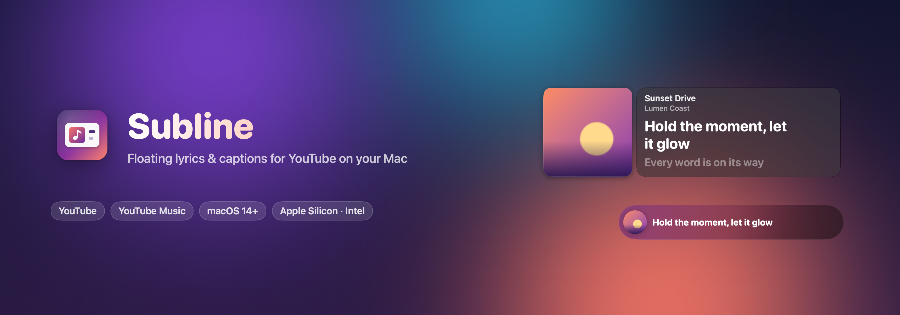
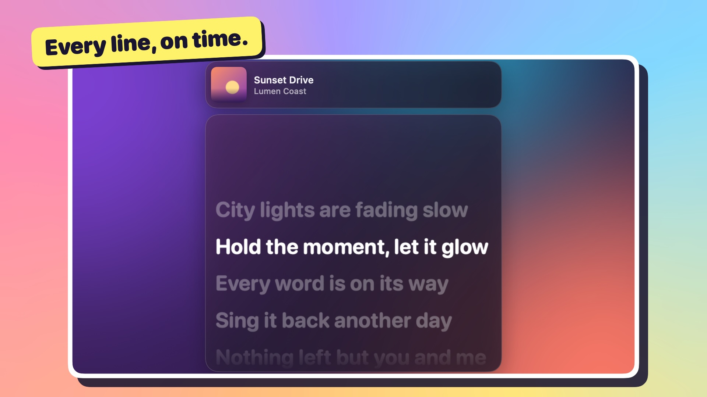
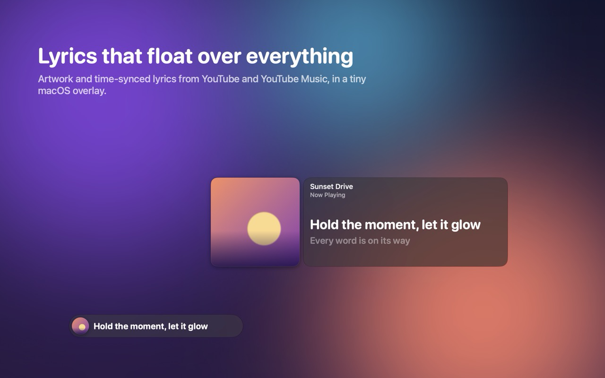
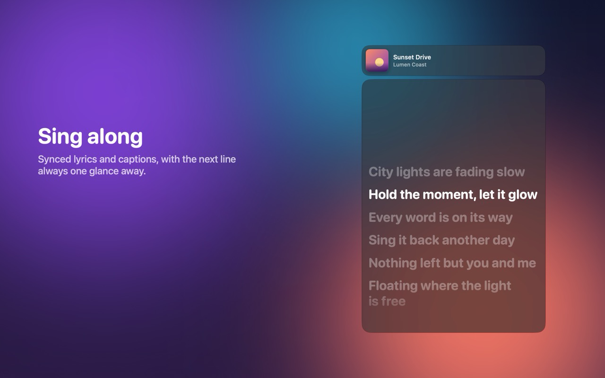
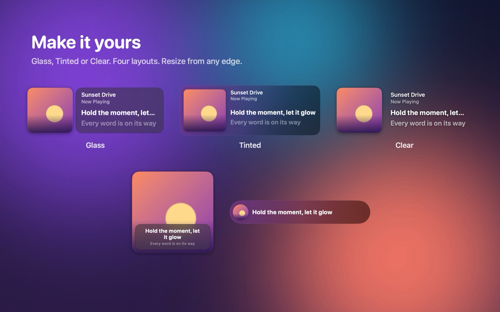
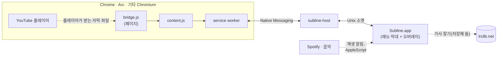
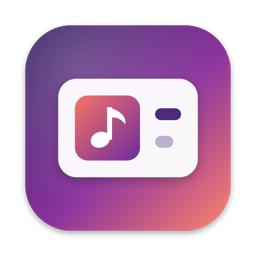

<p align="center">
  
</p>

<p align="center">
  
  
  
  
  
  
</p>

<p align="center">
  <b>YouTube와 YouTube Music의 앨범 아트, 시간에 맞춰 넘어가는 가사와 자막을<br>Mac의 모든 창 위에 떠 있는 작은 유리 패널에 보여 줍니다.</b>
</p>

<p align="center">
  <a href="https://subline.jiun.dev/?lang=ko#film"></a><br>
  <sub><a href="https://subline.jiun.dev/?lang=ko#film">▶ 25초 소개 영상 보기</a> · <a href="https://subline.jiun.dev/?lang=ko">subline.jiun.dev</a></sub>
</p>

<p align="center"><a href="README.md">English</a> · <b>한국어</b></p>

<p align="center">
  <a href="#다운로드">다운로드</a> ·
  <a href="#빠른-시작">빠른 시작</a> ·
  <a href="#기능">기능</a> ·
  <a href="#작동-방식">작동 방식</a> ·
  <a href="#성능">성능</a> ·
  <a href="#개발">개발</a>
</p>

<table>
  <tr>
    <td width="33%"></td>
    <td width="33%"></td>
    <td width="33%"></td>
  </tr>
  <tr>
    <td align="center"><sub><b>모든 창 위에 떠 있는 가사</b></sub></td>
    <td align="center"><sub><b>다음 줄까지 보면서 따라 부르기</b></sub></td>
    <td align="center"><sub><b>글래스 · 틴트 · 투명, 레이아웃 네 가지</b></sub></td>
  </tr>
</table>

재생은 브라우저에서 그대로 합니다. 앱은 곡 정보와 재생 시간, 자막만 받기 때문에 영상을 두 번 디코딩하지 않습니다.

## 기능

<table>
  <tr>
    <td width="50%" valign="top">
      <h4>🎤 시간에 맞춘 가사와 자막</h4>
      YouTube 자막은 플레이어가 받아 오는 것을 그대로 가져옵니다. YouTube Music에서는 페이지에 있는 가사를 먼저 쓰고,
      없으면 LRCLIB에서 찾습니다(Spotify와 Apple Music도 LRCLIB을 씁니다). 시간 정보가 있는 가사를 항상 먼저 고르고, 다음 줄도 미리 보여 줍니다. 줄을 누르면 그 위치로 이동합니다. 가사가 틀렸다면 다른 버전을 고를 수 있습니다.
    </td>
    <td width="50%" valign="top">
      <h4>🌐 두 언어를 함께</h4>
      줄마다 아래에 둘째 줄을 붙입니다. 다른 자막 트랙, YouTube 자동 번역,
      <b>로마자 표기</b>(한국어, 일본어, 중국어), <b>Apple 기기 내 번역</b>(macOS 26) 중에서 고를 수 있습니다.
    </td>
  </tr>
  <tr>
    <td valign="top">
      <h4>🪟 macOS다운 모습</h4>
      macOS 26에서는 Liquid Glass(그 이전에는 HUD 재질)를 쓰고, 앨범 아트에서 색을 뽑습니다. 커버 / 커버 + 자막 / 가사 / 미니 레이아웃이 있고,
      어느 모서리에서든 크기를 바꿀 수 있습니다. 화면 가장자리에 붙고, Dock 위에도 놓을 수 있으며, 클릭 통과 모드도 있습니다.
    </td>
    <td valign="top">
      <h4>⌨️ 키보드만으로</h4>
      <kbd>⌃</kbd><kbd>⌥</kbd><kbd>⌘</kbd><kbd>Space</kbd> 재생/일시 정지 ·
      <kbd>⌃</kbd><kbd>⌥</kbd><kbd>⌘</kbd><kbd>O</kbd> 보이기/숨기기 ·
      <kbd>⌃</kbd><kbd>⌥</kbd><kbd>⌘</kbd><kbd>L</kbd> 클릭 통과.
      오버레이를 오른쪽 클릭하면 모든 옵션이 나옵니다.
    </td>
  </tr>
  <tr>
    <td valign="top">
      <h4>🎧 Spotify와 Apple Music도</h4>
      Spotify 앱과 음악 앱이 보내는 재생 알림을 따라갑니다. 앨범 아트, 재생 위치,
      가사, 재생 조작까지 되고, 따로 설치할 것은 없습니다.
    </td>
    <td valign="top">
      <h4>🏝️ 메뉴 막대와 노치</h4>
      현재 줄을 메뉴 막대 아이콘 옆이나, MacBook 노치에 매달린 검은 섬 모양에 띄울 수도 있습니다
      (노치가 없는 화면에서는 메뉴 막대 아래의 알약 모양으로 나옵니다).
    </td>
  </tr>
  <tr>
    <td valign="top">
      <h4>🪶 아주 가볍게</h4>
      재생 중 CPU 약 1%, 대기 중 약 0.03%, 메모리 25~29MB를 씁니다. 확장 프로그램은 이벤트만 전달하기 때문에 탭이 느려지지 않습니다.
    </td>
    <td valign="top">
      <h4>🔒 처음부터 개인정보 보호</h4>
      계정, 분석, 쿠키가 없습니다. 확장 프로그램은 열려 있는 YouTube Music 페이지에 가사만 물어봅니다. 앱은
      lrclib.net에서 가사를 찾고(곡 제목, 아티스트, 앨범, 길이를 보냅니다) 오프라인에서도 쓸 수 있게 저장해 둡니다. 화면은 영어와 한국어를 지원하고, VoiceOver도 지원합니다.
    </td>
  </tr>
</table>

## 다운로드

[최신 릴리즈](https://github.com/jiunbae/subline/releases/latest)에서 `Subline-<버전>.zip`을 받으세요
(Developer ID 서명과 Apple 공증을 거쳤고, Apple Silicon과 Intel을 모두 지원하며 macOS 14 이상에서 동작합니다). 압축을 풀고 `Subline.app`을 응용 프로그램 폴더로 옮긴 뒤 실행합니다.
그다음 [Chrome 웹 스토어](https://chromewebstore.google.com/detail/dmlghghkjljpbokmhdnhjkpfkpmlhieb)에서 확장 프로그램을 추가합니다. 설정 창에도 링크가 있습니다.

## 빠른 시작

받은 앱을 쓰거나(위 참고), 직접 빌드합니다.

```bash
scripts/build-app.sh --install     # 유니버설 빌드 → ~/Applications에 설치하고 실행
```

메뉴 막대에 ♪가 나타나고 **설정 창**이 열립니다. 그다음은 어디서 듣는지에 따라 다릅니다.

| 듣는 곳 | 할 일 |
|---|---|
| Chrome, Arc, Brave, Edge, Vivaldi의 **YouTube / YouTube Music** | 설정 창에서 확장 프로그램을 추가하고, YouTube 탭을 새로 고친 뒤 재생합니다 |
| **Spotify 또는 Apple Music** | 설치할 것이 없습니다. 재생하면 처음 한 번 macOS가 Subline이 재생 정보를 봐도 되는지 묻습니다. **확인**을 누르세요 |

재생이 시작되면 오버레이가 저절로 나타납니다.

> [!TIP]
> 앱이 실행 중일 때 Finder나 Spotlight에서 다시 열면 설정 창이 상태 페이지로 다시 열립니다.
> 문제 해결 안내와 **권한과 선택 다운로드** 항목이 여기에 있습니다.

### 권한과 다운로드

YouTube용 확장 프로그램과 Spotify/음악 앱용 자동화 권한 말고는 모두 선택 사항입니다.

| 항목 | 요청하는 때 | 이유 | 없으면 |
|---|---|---|---|
| 브라우저 확장 프로그램 | 설정할 때, YouTube / YouTube Music용 | 플레이어 상태와 자막을 읽습니다 | 오버레이에 YouTube가 나오지 않습니다(Spotify/음악 앱은 그대로 됩니다) |
| **자동화**(Spotify, 음악) | Spotify나 음악 앱이 처음 재생될 때 한 번 | 곡, 정확한 재생 위치, 앨범 아트를 읽고, 재생/일시 정지, 다음 곡, 이동 명령을 보냅니다 | 곡 정보는 앱 알림으로 계속 보이지만, 정확한 위치와 음악 앱 앨범 아트, 재생 조작은 빠집니다. 나중에 시스템 설정 › 개인정보 보호 및 보안 › 자동화에서 허용할 수 있습니다 |
| **번역 언어** | 두 번째 언어 › 이 Mac에서 번역을 고를 때만(macOS 26) | Apple 기기 내 번역으로 가사를 내 언어로 옮깁니다. 언어마다 한 번 내려받습니다(수백 MB) | 다른 기능은 그대로입니다. YouTube 자동 번역 자막과 로마자 표기는 내려받을 것이 없습니다 |
| 네트워크: lrclib.net | YouTube Music / Spotify / 음악 앱 곡에서 자동으로 | 시간에 맞춘 가사를 찾습니다(곡 제목, 아티스트, 앨범, 길이를 보냅니다). 이 Mac에 저장해 둡니다 | 오프라인이면 전에 들은 곡은 가사가 나오고, 처음 듣는 곡은 제목만 나옵니다 |

<details>
<summary><b>설정 과정 자세히 보기</b></summary>

1. 앱은 실행할 때 설치된 모든 Chromium 브라우저에 Native Messaging 매니페스트를 등록합니다
   (`~/Library/Application Support/<Browser>/NativeMessagingHosts/dev.jiun.subline.host.json`).
2. 웹 스토어 ID 없이 빌드한 경우 설정 창은 **압축 해제된 확장 프로그램 로드…** 를 보여 줍니다. 이 버튼은 앱에 들어 있는 확장 프로그램을
   `~/Library/Application Support/Subline/extension`에 복사하고, Finder에서 보여 준 뒤 `chrome://extensions`를 엽니다.
   개발자 모드를 켜고 그 폴더를 **압축 해제된 확장 프로그램 로드**로 불러오세요. 개발용 ID는 `npkfiaebcfackgbinodgjobdlmeceaij`로 고정돼 있습니다.
3. 압축 해제해서 불러온 확장 프로그램은 새로 고치기 전까지 예전 코드로 동작합니다. 연결된 확장 프로그램이 앱에 들어 있는 것보다 오래됐으면
   메뉴 막대 메뉴에 그렇게 표시됩니다.
4. 앱이 실행 중이 아니면 확장 프로그램이 연결을 시도할 때 앱이 실행됩니다. 메뉴에서 종료했다면
   직접 다시 열 때까지 꺼진 상태로 있습니다.

Chrome 웹 스토어 게시(공개 등록, 게시됨)와 클릭 한 번으로 설치하는 경로: [store/SUBMISSION.md](store/SUBMISSION.md)
</details>

<details>
<summary><b>할 수 있는 모든 것</b></summary>

| 동작 | 방법 |
|---|---|
| 옮기기 | 패널을 끌어서 옮깁니다. 화면 가장자리와 모서리에 붙습니다 |
| 크기 조절 | 아무 가장자리나 모서리를 끕니다(다른 앱이 앞에 있어도 커서가 바뀝니다). 끄는 쪽은 화면 가장자리에서 멈추고, 반대쪽은 움직이지 않습니다 |
| 위치 | 메뉴 막대 아래라면 Dock 위를 포함해 어디든 놓을 수 있습니다. 화면 가장자리나 Dock 바로 위에 붙습니다 |
| 옵션 | 오버레이를 오른쪽 클릭하거나(메뉴 막대와 같은 메뉴), **모양…**(⌘,)에서 미리 보기로 고릅니다 |
| 스타일 | **글래스**(투명, macOS 26 이상에서는 Liquid Glass 위에 글자, 그 이전에는 HUD 재질), **틴트**, **투명** |
| 자동으로 보이기/숨기기 | 기본으로 켜져 있습니다. 재생이 시작되면 나타나고, 탭이 사라지고 2.5초 뒤나 5분 동안 일시 정지하면 사라집니다. 직접 숨기면 지금 영상이 끝날 때까지 숨겨 둡니다 |
| 재생/일시 정지 | 패널 더블클릭 · 마우스를 올렸을 때 나오는 버튼 · ⌃⌥⌘Space |
| 오버레이 보이기/숨기기 | ⌃⌥⌘O |
| 클릭 통과(마우스가 패널을 지나감) | ⌃⌥⌘L 또는 메뉴 막대 → 클릭 통과 |
| 레이아웃 | 메뉴 막대 → 레이아웃: 커버 / 커버 + 자막 / 가사 / 미니 |
| 자막 싱크 | 메뉴 막대 → 자막 → 더 일찍/더 늦게(±0.5초) |
| YouTube 자막 | 플레이어가 자막을 받아 올 때 그대로 가져옵니다. 자막(CC)이 꺼져 있으면 앱이 잠깐 켰다가 원래대로 돌립니다(자막 → **자막 자동으로 불러오기**, 기본으로 켜짐. **현재 동영상 자막 불러오기**로 직접 할 수도 있습니다) |
| 자막 언어 | 자막 → 언어, 또는 마우스를 올렸을 때 나오는 CC 버튼. 고른 언어를 기억했다가, 그 언어가 있는 다음 영상에도 적용합니다(직접 만든 자막을 자동 생성 자막보다 먼저 고릅니다). 플레이어의 자막 켜짐 상태와 언어는 원래대로 돌려놓습니다 |
| 자동 번역 | 언어 / 두 번째 언어 → 자동 번역 ▸(시스템 언어가 먼저 나옵니다). 플레이어가 자막을 번역합니다. 예: 영어 원문 + 한국어 번역 |
| 자동 생성 자막 | YouTube가 주는 단어별 시간 정보로 문장을 다시 만듭니다(문장 부호, 쉼, 한중일 약 26자 / 라틴 문자 약 48자에서 끊습니다). YouTube의 흘러가는 자막 창을 그대로 쓰지 않습니다 |
| 두 번째 언어 | 자막 → 두 번째 언어(또는 CC 버튼). 보조 트랙을 현재 줄 아래에, 가사 레이아웃에서는 각 줄 아래에 보여 줍니다. 주 언어처럼 기억하고, 다음 줄 미리 보기 대신 나옵니다 |
| 다음 줄 | 다음 줄을 현재 줄 아래에 흐리게 보여 줍니다. 간주 중에는 ♪가 나옵니다(자막 → 다음 줄 보기) |
| VoiceOver | 오버레이를 "제목, 아티스트"로 읽고 현재 줄을 값으로 알려 줍니다. 재생/일시 정지, 다음, 이전, 10초 이동을 동작으로 제공해서 마우스를 올렸을 때 나오는 버튼이 없어도 됩니다. 가사 줄은 버튼이고, 진행 막대는 조절할 수 있습니다. 메뉴 막대 → 10초 뒤로/앞으로 |
| 재생 중인 것이 없을 때 | 직접 오버레이를 열었을 때만(⌃⌥⌘O) 나옵니다. 마지막 영상과 ▶ 이어서 재생 버튼(탭이 열려 있으면 그 탭에서, 아니면 기본 브라우저에서 엽니다), 최근 영상 최대 3개를 보여 줍니다. 메뉴 막대 → 최근 재생에서 목록을 보고 지울 수 있습니다(이 Mac에만 저장됩니다) |
| 일시 정지 | 오버레이가 어둡고 흐려지며, 제목 옆에 ❚❚ 표시가 붙습니다(커버에서는 일시 정지 기호). 5분 뒤 사라집니다 |
| 글자가 없을 때 | 커버 + 자막 레이아웃은 빈칸 대신 제목을 크게 보여 주고, 상태 표시를 붙입니다: 자막 불러오는 중… / 자막 불러오기 |
| 시간 정보 없는 가사 | YouTube Music에는 가사는 있지만 시간 정보가 없는 곡이 있습니다. 이때는 곡이 재생된 정도로 지금 부르는 구절을 추정합니다(줄 길이로 가중치를 주고, 전주와 후주는 뺍니다). 가사 레이아웃은 그 구절을 밝게 표시해 가운데에 두고 "대략적인 위치"라고 알려 주며, 카드에는 그 구절의 첫 줄들이 나옵니다. 이때는 줄을 눌러도 이동하지 않습니다 |
| 가사(YouTube Music, Spotify, Apple Music) | 앱이 LRCLIB에서 찾습니다(정확히 일치하는 곡을 찾고, 현지화된 이름이나 `(Official Audio)` 같은 꼬리를 떼고 다시 찾은 뒤, 제목, 아티스트, 길이 ±3초로 검색합니다. 연주곡은 건너뜁니다). 디스크에 저장하기 때문에 들어 본 곡은 오프라인에서도 나옵니다. LRCLIB에 없는 곡은 제목만 나옵니다 |
| 가사 버전 | 메뉴 → 가사: 같은 곡의 다른 LRCLIB 버전(곡마다 기억합니다), 이 곡은 가사 숨기기, 다시 찾기 |
| 곡별 싱크 | 자막 → 더 일찍/더 늦게는 곡이나 영상마다 기억합니다. 가사 레이아웃에서 줄을 누르면 그 줄부터 재생합니다(맞춘 싱크를 반영합니다) |
| 로마자 표기 / 기기 내 번역 | 두 번째 언어 → 로마자 표기(한국어 국어의 로마자 표기법, 일본어 읽기, 병음), 또는 이 Mac에서 번역(Apple 번역, macOS 26. 처음 한 번 언어를 내려받을지 macOS가 묻습니다) |
| Spotify와 Apple Music | 브라우저 탭처럼 보여 주고, 가사와 재생 조작(재생/일시 정지, 다음/이전, 이동)을 지원합니다. 처음 한 번 macOS가 자동화 권한을 묻습니다. 메뉴 → Spotify·Apple Music도 따라가기로 끌 수 있습니다 |
| 메뉴 막대 / 노치 | 메뉴 → 현재 줄 함께 표시 → 메뉴 막대에 / 노치 아래에(노치가 없는 화면에서는 화면 위쪽 가운데에) |
</details>

## 작동 방식



확장 프로그램은 플레이어가 자막을 받아 오는 요청을 지켜볼 뿐이라, YouTube를 직접 호출하거나 쿠키를 읽거나 네트워크 요청을 보내지 않습니다.
재생 시간은 앱이 직접 계산하고, 탭은 5초마다 보정 값과 재생/일시 정지/이동 이벤트를 보냅니다.
자세한 내용: [PROTOCOL.md](PROTOCOL.md) · [PLAN.md](PLAN.md) · [extension/README.md](extension/README.md) (영어)

## 설치, 업데이트, 제거

| | |
|---|---|
| **설치** | `Subline-<버전>.zip`(`scripts/package-app.sh`로 만든 파일)의 압축을 풀고, `Subline.app`을 `/Applications`나 `~/Applications`로 옮긴 뒤 한 번 실행하고 확장 프로그램을 추가합니다. 유니버설(Apple Silicon, Intel)이고 macOS 14 이상에서 동작합니다. Apple Silicon과 Rosetta로 돌린 Intel 빌드에서 테스트했습니다 |
| **업데이트** | 메뉴 막대에서 종료하고, 앱을 바꾼 뒤 다시 엽니다. 열 때마다 모든 브라우저에 다시 등록하기 때문에 앱을 옮겨도 괜찮습니다. 압축 해제해서 불러온 확장 프로그램은 브라우저의 확장 프로그램 페이지에서 새로 고칩니다. 예전 이름(Now Playing)에서 넘어온다면 Subline을 열기만 하면 됩니다. 환경설정, 최근 재생, 데이터 폴더를 옮기고, 확장 프로그램이 새로 고쳐질 때까지 예전 브라우저 등록도 계속 동작하게 둡니다 |
| **제거** | `scripts/uninstall.sh --dry-run`으로 지울 항목을 보고, `scripts/uninstall.sh`로 앱, 브라우저 등록, Chrome 설치 요청, `~/Library/Application Support/Subline`, 환경설정을 지웁니다. 그다음 브라우저에서 확장 프로그램을 제거합니다 |
| **언어** | 시스템 언어(영어, 한국어)를 따릅니다. 이 앱만 한국어로 쓰려면 `defaults write dev.jiun.subline AppleLanguages -array ko`(되돌리려면 `defaults delete dev.jiun.subline AppleLanguages`) |

## 성능

| | 결과 | 목표 |
|---|---|---|
| 앱 / 호스트 메모리(RSS가 아닌 `footprint`) | 25~29MB / 2.4MB | 80MB 이하 |
| CPU, 대기 / 글자 없이 재생 | 약 0.03% / 약 0.03~0.1% | 0.2% 이하 |
| CPU, 가사 속도(3초마다 한 줄): 가사 / 커버 + 자막 | 약 1.1% / 약 1.0% | 1% 이하(목표 수준) |
| CPU, 빠른 자동 생성 자막(1500줄, 1.3초마다): 가사 / 커버 + 자막 | 약 1.0% / 약 1.1%(이전 13% / 4.1%) | 1% 이하 |
| YouTube 탭 메인 스레드, 확장 프로그램 있음 / 없음(40초 재생) | 2.5~2.8% / 2.5~3.3%(차이를 측정할 수 없음) | |
| 재생 중 앱 ↔ 확장 프로그램 메시지 | 5초마다 시간 1번(+ 이벤트). 고치기 전 피드백 루프는 초당 약 1,500번까지 갔습니다 | |

재생 중 비용은 거의 모두 애니메이션 프레임에서 나옵니다. SwiftUI는 글자를 CPU로 그리기 때문입니다. 측정해서 얻은 규칙은 다음과 같습니다.
가사 줄마다 암묵적 애니메이션을 걸지 않습니다(가사 레이아웃 비용의 약 90%였습니다). 줄이 2초보다 빨리 바뀌거나 동작 줄이기가 켜져 있으면
전환 효과를 건너뛰고 스크롤을 바로 옮깁니다. 줄마다 흐림/크기 효과, 글자 그림자, 스프링 꼬리를 쓰지 않습니다. 다음 줄 미리 보기는 따로 페이드하지 않고 글자만 바꿉니다.
Rust 코어도 검토했지만 쓰지 않았습니다. 화면을 그리지 않는 앱 작업은 CPU 약 0.03%이고, Rust로 중계해도 아낄 수 있는 메모리는 1~3MB 정도입니다.
측정은 실제 탭이 아니라 고정된 내용을 다시 재생하는 `soak`으로 합니다(실제 탭 수치는 재생 상태와 마우스 움직임에 따라 크게 흔들립니다).

## 개발

```bash
ARCHS=arm64 scripts/build-app.sh             # 한 아키텍처만 빠르게 빌드
cd app && swift test                         # Core: 프레이밍, 메시지, 시간 보간, 자막 타임라인, 탭 선택
node --test extension/test/*.test.mjs        # 확장 프로그램: JSON3/ASR/LRC 파서, VM 안의 service worker와 bridge
scripts/store-assets.sh                      # 웹 스토어 이미지와 README 배너를 실제 화면으로 렌더
scripts/render-landing-media.sh              # 랜딩 영상과 히어로 루프(site/shots)를 실제 화면으로 오프스크린 렌더
```

<details>
<summary><b>릴리즈: 서명과 공증</b></summary>

로컬 빌드는 ad-hoc 서명입니다. `scripts/package-app.sh`에 `CODESIGN_IDENTITY`와 공증 정보(`NOTARY_PROFILE`, 또는 App Store Connect API 키라면
`NOTARY_KEY` / `NOTARY_KEY_ID` / `NOTARY_ISSUER`)를 주면 Developer ID로 서명하고, 공증하고, 스테이플한 뒤 압축합니다. 릴리즈에는 `RELEASE=1`을 씁니다.
압축 파일이 서명과 공증을 거치지 않으면 실패합니다. 공증하지 않으면 결과물 이름은 `Subline-<버전>-local.zip`이 됩니다. 마케팅 버전은 `VERSION`에서, 빌드 번호는 git 커밋 수에서 가져옵니다.

릴리즈에서 오버레이 모양이 바뀌면 랜딩 페이지의 영상과 히어로 루프를 실제 화면으로 다시 렌더합니다.
`scripts/render-landing-media.sh`(1분쯤 걸리고 ffmpeg가 필요합니다)가 `site/shots`에 쓰고,
`.github/workflows/pages.yml`이 [subline.jiun.dev](https://subline.jiun.dev)에 게시합니다.
`scripts/render-landing-media.sh preview`는 확인용 정지 화면을 `build/landing-preview`에 씁니다.
</details>

<details>
<summary><b>검증 도구</b></summary>

| 스크립트 | 확인하는 것 |
|---|---|
| `scripts/perf/cpu.sh [fast\|lyrics\|nocues] [layout] [style]` | 고정된 합성 재생에서 CPU와 메모리(실제 탭과 달리 수치가 안정적입니다) |
| `scripts/perf/feed.py MODE SECONDS` | 앱에 합성 상태를 보냅니다: `lyrics`, `fast`, `none`, `loading`, `gap`, `dual`, `paused` |
| `scripts/ui/run.sh` | 실제 포인터 입력: 8개 핸들에서 크기 조절(커서와 움직이는 가장자리), Dock 위치, 오른쪽 클릭 메뉴 |
| `node scripts/e2e/youtube.mjs <url> [secs] [--cc-off] [--expect cur=es --expect 'n2>0' …] [--expect-cc same] [--debug]` | 압축 해제한 확장 프로그램을 넣은 Chromium에서 실제 YouTube를 열고 앱 상태를 출력합니다. 기대값이 틀리면 1로 종료합니다(`debugDump`가 필요합니다). `--debug`는 bridge 로그를 보여 줍니다 |
| `localStorage['subline-debug']='1'`(YouTube 탭의 콘솔에서) | 그 탭 콘솔에 bridge 진단을 출력합니다: 자막 선택, 플레이어 시도, 가져온 자막 요청과 거절된 요청(예: 429). 페이지 밖으로 나가는 것은 없습니다 |

`scripts/ui`와 `scripts/e2e`는 실제 포인터를 움직이거나 브라우저를 엽니다. 연 것은 끝나면 닫습니다.
</details>

<details>
<summary><b>디버깅</b></summary>

```bash
defaults write dev.jiun.subline debugDump -bool true   # 상태를 ~/Library/Application Support/Subline/debug-state.json에 씁니다
```
</details>

<p align="center"><br><sub>따라 부르는 사람들을 위해 만들었습니다.</sub></p>
