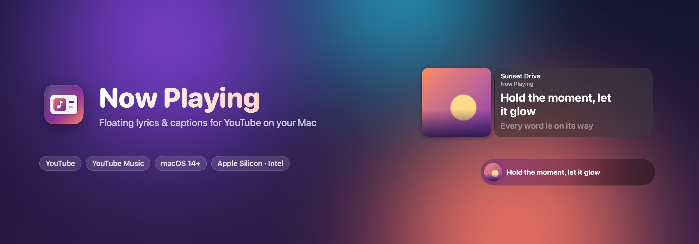
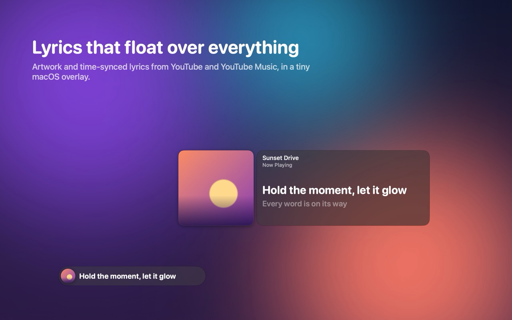
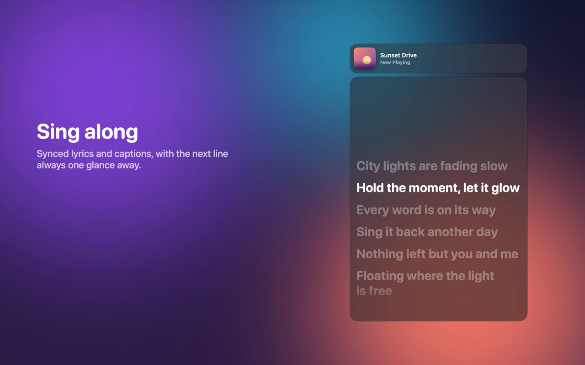
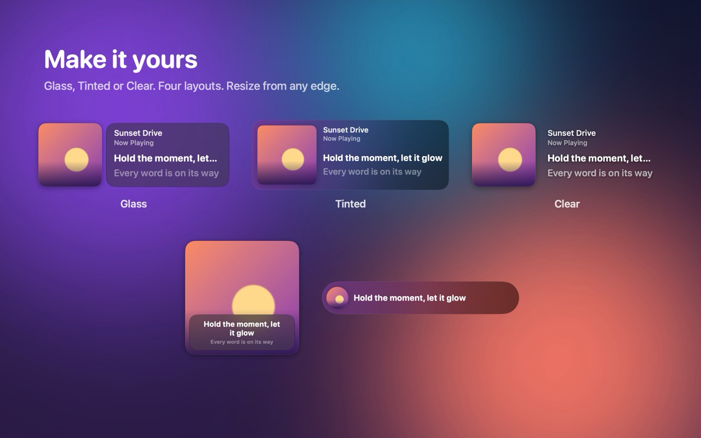
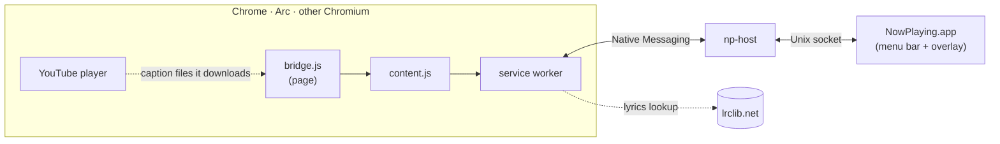
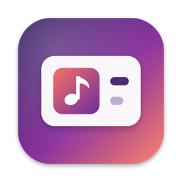

<p align="center">
  
</p>

<p align="center">
  
  
  
  
  
  
</p>

<p align="center">
  <b>Artwork and time-synced lyrics or captions from YouTube and YouTube Music,<br>in a tiny glass panel that floats above everything on your Mac.</b>
</p>

<p align="center">
  <a href="#quick-start">Quick start</a> ·
  <a href="#features">Features</a> ·
  <a href="#how-it-works">How it works</a> ·
  <a href="#performance">Performance</a> ·
  <a href="#development">Development</a>
</p>

<table>
  <tr>
    <td width="33%"></td>
    <td width="33%"></td>
    <td width="33%"></td>
  </tr>
  <tr>
    <td align="center"><sub><b>Lyrics that float over everything</b></sub></td>
    <td align="center"><sub><b>Sing along, next line included</b></sub></td>
    <td align="center"><sub><b>Glass · Tinted · Clear, four layouts</b></sub></td>
  </tr>
</table>

Playback stays in your browser. The app only receives metadata, the clock and captions, so nothing is decoded twice.

## Features

<table>
  <tr>
    <td width="50%" valign="top">
      <h4>🎤 Synced lyrics &amp; captions</h4>
      YouTube captions captured from the player itself, YouTube Music lyrics from LRCLIB, with the next line previewed.
      Auto-generated captions are rebuilt into real sentences.
    </td>
    <td width="50%" valign="top">
      <h4>🌐 Two languages at once</h4>
      Pick the caption language, add a second one underneath, or let YouTube auto-translate
      (e.g. English original + Korean translation). Your choice is remembered.
    </td>
  </tr>
  <tr>
    <td valign="top">
      <h4>🪟 Feels native</h4>
      Liquid Glass on macOS 26 (HUD material before), artwork-tinted colors, Cover / Cover + Line / Lyrics / Mini layouts,
      resize from any edge, edge snapping, sits over the Dock, click-through mode.
    </td>
    <td valign="top">
      <h4>⌨️ Hands on the keyboard</h4>
      <kbd>⌃</kbd><kbd>⌥</kbd><kbd>⌘</kbd><kbd>Space</kbd> play/pause ·
      <kbd>⌃</kbd><kbd>⌥</kbd><kbd>⌘</kbd><kbd>O</kbd> show/hide ·
      <kbd>⌃</kbd><kbd>⌥</kbd><kbd>⌘</kbd><kbd>L</kbd> click-through.
      Right-click the overlay for every option.
    </td>
  </tr>
  <tr>
    <td valign="top">
      <h4>🪶 Featherweight</h4>
      ~1% CPU while playing, ~0.03% idle, 25–29 MB. The extension only relays events and adds no measurable cost to the tab.
    </td>
    <td valign="top">
      <h4>🔒 Private by design</h4>
      No accounts, analytics or cookies. Playback info goes only to the app on your Mac; lyric lookups send
      title, artist, album and length to lrclib.net. English and Korean UI, VoiceOver support.
    </td>
  </tr>
</table>

## Quick start

```bash
scripts/build-app.sh --install     # universal build → ~/Applications, then launches it
```

1. A ♪ appears in the menu bar and a **setup window** walks you through adding the extension.
2. Reload your YouTube tabs and press play. The overlay appears on its own.

> [!TIP]
> Opening the app again (Finder or Spotlight) while it runs brings the setup window back as a status page,
> with troubleshooting for browsers that can't reach it.

<details>
<summary><b>What setup does, in detail</b></summary>

1. On launch the app registers the Native Messaging manifest for every installed Chromium browser
   (`~/Library/Application Support/<Browser>/NativeMessagingHosts/com.nowplaying.host.json`).
2. Without a Web Store ID the setup window offers **Load Unpacked Extension…**, which copies the bundled extension to
   `~/Library/Application Support/NowPlaying/extension`, reveals it in Finder and opens `chrome://extensions`.
   Turn on Developer mode, then **Load unpacked** that folder. The dev ID is fixed as `npkfiaebcfackgbinodgjobdlmeceaij`.
3. Unpacked extensions keep running old code until reloaded. When the connected extension is older than the
   one bundled with the app, the menu bar menu says so.
4. If the app isn't running, the extension's connection attempt launches it. After you quit from the menu,
   it stays quit until you open it yourself.

Publishing to the Chrome Web Store (unlisted) and the one-click install path: [store/SUBMISSION.md](store/SUBMISSION.md).
</details>

<details>
<summary><b>Everything you can do</b></summary>

| Action | How |
|---|---|
| Move | Drag the panel. It snaps to screen edges and corners |
| Resize | Drag any edge or corner (the cursor changes, also while another app is frontmost). Dragged edges stop at the screen edge; the opposite edges never move |
| Placement | Anywhere below the menu bar, including over the Dock. Snaps to the screen edge or to just above the Dock |
| Options | Right-click the overlay (same menu as the menu bar), or **Appearance…** (⌘,) for the gallery |
| Style | **Glass** (transparent; text on Liquid Glass on macOS 26+, HUD material before), **Tinted**, **Clear** |
| Show/hide automatically | On by default: appears when playback starts, fades 2.5 s after the tab goes away or after 5 min paused. A manual hide lasts for the current video |
| Play/pause | Double-click the panel · hover controls · ⌃⌥⌘Space |
| Show/hide overlay | ⌃⌥⌘O |
| Click-through (mouse passes through) | ⌃⌥⌘L or the menu bar → Click-Through |
| Layouts | Menu bar → Layout: Cover / Cover + Line / Lyrics / Mini |
| Caption sync | Menu bar → Captions → Earlier/Later (±0.5s) |
| Captions on YouTube | Captured from the player's own caption request. If CC is off, the app briefly toggles CC and restores it (Captions → **Auto-Connect Captions**, on by default; **Connect Captions** does it manually) |
| Caption language | Captions → Language, or the CC pill in the hover controls. The choice is remembered and applied to later videos that offer that language (manual tracks before auto-generated). The player's own CC state and language are restored |
| Auto-translate | Language / Second Language → Auto-translate ▸ (your system languages first): the player translates its caption track, e.g. English original + Korean translation |
| Auto-generated captions | Rebuilt into sentences from YouTube's per-word timing (breaks at punctuation, pauses, or ~26 CJK / 48 Latin chars) instead of its rolling windows |
| Second language | Captions → Second Language (or the CC pill): a sub track shown under the main line, and under each row in the Lyrics layout. Remembered like the main language; it replaces the next-line preview |
| Next line | The following line is shown dimmed under the current one; ♪ during instrumental gaps (Captions → Show Next Line) |
| VoiceOver | The overlay is announced as "title, artist" with the current line as its value, and offers Play/Pause, Next, Previous and Skip ±10 s as actions (the hover controls aren't needed). Lyric lines are buttons; the progress line is adjustable. Menu bar → Skip Back/Forward 10 Seconds |
| Nothing playing | Shown only when you open the overlay yourself (⌃⌥⌘O): the last video with ▶ resume (plays in its tab if still open, otherwise opens it in the default browser) and up to 3 more recent ones. Menu bar → Recently Played lists them and can clear the list (kept on this Mac only) |
| Paused | The overlay dims and desaturates, with a ❚❚ mark by the title (a pause glyph on Cover); it fades out after 5 min |
| No text | Cover + Line shows the title larger instead of an empty slot, with a status chip: Loading captions… / Load captions / Show lyrics (unsynced) |
| Lyrics on YouTube Music | Synced lyrics from LRCLIB (retried with localized/`(Official Audio)` suffixes removed, then one LRCLIB search matched by title, artist and length ±3 s, skipping instrumentals). Songs LRCLIB doesn't have show the title only |
</details>

## How it works



The extension observes the player's own caption requests, so it never calls YouTube itself or reads cookies.
The app interpolates the playback clock locally; the tab sends a correction every 5 s plus play/pause/seek events.
Details: [PROTOCOL.md](PROTOCOL.md) · [PLAN.md](PLAN.md) · [extension/README.md](extension/README.md)

## Install, update, uninstall

| | |
|---|---|
| **Install** | Unzip `NowPlaying-<version>.zip` (from `scripts/package-app.sh`), move `NowPlaying.app` to `/Applications` or `~/Applications`, open it once and add the extension. Universal (Apple Silicon and Intel), macOS 14 or later; tested on Apple Silicon and the Intel build under Rosetta |
| **Update** | Quit from the menu bar, replace the app, open it again. Opening it re-registers every browser, so moving it is safe. Reload an unpacked extension on the browser's Extensions page |
| **Uninstall** | `scripts/uninstall.sh --dry-run` lists everything, `scripts/uninstall.sh` removes the app, browser registrations, Chrome install requests, `~/Library/Application Support/NowPlaying` and preferences. Then remove the extension in the browser |
| **Language** | Follows the system (English, Korean). Korean for this app only: `defaults write com.nowplaying.app AppleLanguages -array ko` (undo with `defaults delete com.nowplaying.app AppleLanguages`) |

## Performance

| | Result | Target |
|---|---|---|
| App / host memory footprint (`footprint`, not RSS) | 25–29 MB / 2.4 MB | ≤ 80 MB |
| CPU, idle / playing with no text | ~0.03% / ~0.03–0.1% | ≤ 0.2% |
| CPU, lyric pace (a line every 3 s): Lyrics / Cover + Line | ~1.1% / ~1.0% | ≤ 1% (at target) |
| CPU, fast auto-generated captions (1500 lines, every 1.3 s): Lyrics / Cover + Line | ~1.0% / ~1.1% (was 13% / 4.1%) | ≤ 1% |
| YouTube tab main thread, with vs without the extension (40 s playing) | 2.5–2.8% vs 2.5–3.3% (no measurable difference) | |
| App ↔ extension messages while playing | 1 clock per 5 s (+ events); a fixed feedback loop had reached ~1,500/s | |

Almost all playing cost is animation frames, which SwiftUI renders text for on the CPU. Rules that came out of
the measurements: no implicit animation on every lyric row (it was ~90% of the Lyrics cost); when lines change
faster than every 2 s (or Reduce Motion is on) skip transitions and jump-scroll; no per-line blur/scale, text
shadows or spring tails; the next-line preview swaps text without its own fade. A Rust core was considered
and rejected: non-rendering app work is ~0.03% CPU, and a Rust relay would save at most ~1–3 MB.
Measure with `soak` replays of fixed content, not a live tab (live numbers swing with playback and pointer activity).

## Development

```bash
ARCHS=arm64 scripts/build-app.sh             # fast single-architecture build
cd app && swift test                         # Core: framing, messages, clock interpolation, cue timeline, tab selection
node --test extension/test/*.test.mjs        # Extension: JSON3/ASR/LRC parsers, service worker and bridge in a VM
scripts/store-assets.sh                      # Web Store images + README banner, rendered from the real views
```

<details>
<summary><b>Release: signing and notarization</b></summary>

Local builds are ad-hoc signed. `scripts/package-app.sh` signs with a Developer ID, notarizes, staples and zips when given
`CODESIGN_IDENTITY` and notary credentials (`NOTARY_PROFILE`, or `NOTARY_KEY` / `NOTARY_KEY_ID` / `NOTARY_ISSUER`
for an App Store Connect API key). The marketing version comes from `VERSION`, the build number from the git commit count.
</details>

<details>
<summary><b>Verification tools</b></summary>

| Script | What it checks |
|---|---|
| `scripts/perf/cpu.sh [fast\|lyrics\|nocues] [layout] [style]` | CPU and memory for a fixed synthetic replay (stable, unlike a live tab) |
| `scripts/perf/feed.py MODE SECONDS` | Feeds synthetic states to the app: `lyrics`, `fast`, `none`, `loading`, `gap`, `dual`, `paused` |
| `scripts/ui/run.sh` | Real pointer input: resize from all 8 handles (cursor + which edges move), Dock placement, context menu |
| `node scripts/e2e/youtube.mjs <url> [secs] [--cc-off] [--expect cur=es --expect 'n2>0' …] [--expect-cc same] [--debug]` | Real YouTube in Chromium with the unpacked extension; prints the app's state and exits 1 if an expectation fails (needs `debugDump`). `--debug` shows the bridge's log |
| `localStorage['nowplaying-debug']='1'` (in a YouTube tab's console) | Bridge diagnostics in that tab's console: caption selections, each player attempt, captured / refused (e.g. 429) caption requests. Nothing leaves the page |

`scripts/ui` and `scripts/e2e` move the real pointer / open a browser; they close what they open.
</details>

<details>
<summary><b>Debugging</b></summary>

```bash
defaults write com.nowplaying.app debugDump -bool true   # writes state to ~/Library/Application Support/NowPlaying/debug-state.json
```
</details>

<p align="center"><br><sub>Made for people who sing along.</sub></p>
